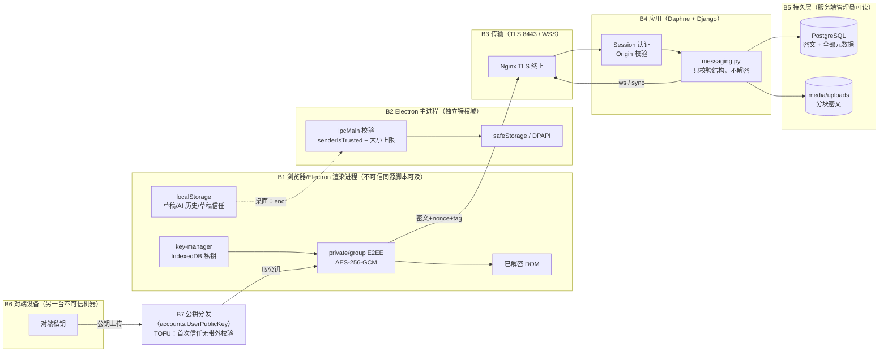
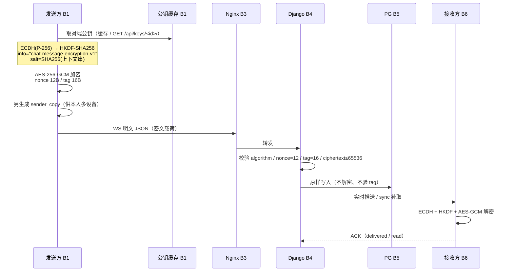

# ADR-P4-04：端到端加密跨平台威胁模型与数据流（P4 T38 / Issue #165）

> 状态：**设计基线已落笔，跨端验收未完成**。核对日期 2026-10-18，代码基线 `cfe53be`。
> 覆盖范围：现有**浏览器端（Web）**与**Windows 桌面端（Electron）**的加密实现，以及服务端能看到的全部明文面。
> **不覆盖**：Android 端（工程尚未落地，见 #149–#157）、设备级独立密钥与撤销（#167–#169）、历史密钥迁移（#170）。
> 本文不构成任何安全验收结论；它只把"现在到底是什么"写清楚，并标出哪些是已实现的控制、哪些是已知缺口。

相关文档：[浏览器与桌面安全威胁模型](../iChat%20Pro%20浏览器端安全威胁模型.md)（2026-10-07 旧基线，本文是其跨平台扩展）、[现行协议](protocol.md) §7 敏感数据存储边界、[部署安全说明](../iChat%20Pro%20部署安全说明.md)、[风险登记册](risk-register.md)。

---

## 0. 本文的证据等级

按 [conventions.md §3](../handoff/conventions.md) 的来源优先级：**实际代码 > 具体 CI run > 专项验收 > Issue 文字**。

本文每一行"现行实现"都标注了 `文件:行`，对应 `cfe53be` 工作树。**行号会随代码漂移**，检索时优先用符号名（常量名、函数名、模型字段名）而不是行号。

凡未在本轮核对中复验的（生产服务器实际环境变量、第三方渗透测试结论、Windows 安装版运行时行为），一律写"未验证"，不写"通过"。

---

## 1. 资产（Assets）

### 1.1 客户端持有、绝不外发的秘密

| 编号 | 资产 | 存储位置 | 静态保护 | 证据 |
| --- | --- | --- | --- | --- |
| A1 | 身份私钥（ECDH P-256） | IndexedDB `ichat-e2ee-keys` / store `identity_private_keys`，键 `<userId>` 与 `<userId>:v<keyVersion>` | **不可导出 CryptoKey**（结构化克隆存储，`exportKey` 会失败） | `static/js/key-manager.js:4`、`:6`、`:22-24`、`:181`（`importPrivateKey(privateKeyJwk, false)`）、`:141` |
| A2 | 身份的**待导出 JWK** | `sessionStorage['ichat_identity_key_pending_backup:<userId>']` | 桌面：DPAPI 密文（`enc:` 前缀）；**Web：明文 JSON** | `key-manager.js:43`（桌面）、`:56-57`（Web 明文，附告警） |
| A3 | 文件会话密钥（AES-256-GCM，32 字节） | 仅内存（`UploadSession.fileKeyBytes`） | 不落盘；每持有者一份 `wrapped key` 上传 | `static/js/file-transfer.js:304-305`、`:320`、`:953` |
| A4 | 聊天明文（解密后） | 仅内存 + 已渲染 DOM | 不持久化（例外见 A5/A6） | `static/js/chat.js:101`、`:323`、`:6079` |
| A5 | 聊天草稿 | `localStorage['ichat_drafts']` | 桌面：DPAPI 密文；**Web：明文 JSON** | `chat.js:447`、`:259-260` |
| A6 | AI 助手历史（含用户提问原文） | `localStorage['ichat_ai_history[:<sessionId>]']` | 同 A5 | `chat.js:9024`、`:9080`、`:9095` |
| A7 | 对端信任指纹 | `localStorage['ichat_peer_identity:<userId>']` → `{user_id, versions:{v: fp}}` | 明文（公开材料，但**是 TOFU 判据**） | `private-chat-e2ee.js:5`、`:296-297`；`group-chat-e2ee.js:7`、`:329-330` |

### 1.2 会话与账户凭据

| 编号 | 资产 | 存储位置 | 保护 | 证据 |
| --- | --- | --- | --- | --- |
| A8 | 登录会话 | HttpOnly Session Cookie | 生产 `SECURE`/`HTTPONLY`；**未显式设置 `SAMESITE`** | `ichat_pro/settings.py:288-289`；settings 内 `SAMESITE` 无匹配 |
| A9 | CSRF Token | Cookie | 生产 `SECURE` | `settings.py:287` |
| A10 | `SECRET_KEY` | 进程环境变量 | `DEBUG=False` 时缺失即启动失败；**`DEBUG=True` 时有硬编码默认值** | `settings.py:30-31`、`:33-36` |

### 1.3 服务端持有、且**始终可读**的数据

这一节是本文最重要的部分：E2EE 只保护**消息内容**，不保护下列任何一项。

| 类别 | 具体字段 | 模型 | 证据 |
| --- | --- | --- | --- |
| 参与者 | 发送者、接收者、每收件人的 `receiver` | `EncryptedMessage` / `GroupMessageRecipient` | `chat/models.py:238`、`:243`、`:376` |
| 关系图 | 会话成员、角色、加入/退出时间、未读数、置顶/静音/归档、`cleared_at` | `ConversationMember` | `chat/models.py:120-140` |
| 时间 | `created_at` / `updated_at` / `deleted_at` / `recalled_at` | 消息各模型 | `chat/models.py:267-269`、`:277` |
| 类型与规模 | `message_type`、文件总字节数、分块数与大小、`ciphertext_sha256` | `EncryptedMessage` / `EncryptedFile` | `chat/models.py:248`、`:614-663` |
| 回复结构 | `reply_to_message_id` | `EncryptedMessage` | `chat/models.py:263` |
| 密钥版本 | `sender_key_version` / `receiver_key_version` / `membership_version` | 消息各模型 | `chat/models.py:260-261`、`:384-392` |
| 在线状态 | `last_seen`、在线/离线 | `UserPresence` | `chat/models.py:514-515` |
| 群资料 | 群名、头像、群主 | `Conversation` | `chat/models.py:21-29` |
| **群公告正文** | `content`（**明文 TextField**） | `GroupAnnouncement` | `chat/models.py:577` |
| **举报正文** | `details`（**明文 TextField**） | `ChatReport` | `chat/models.py:482` |
| **LLM API Key** | 服务端用 `SECRET_KEY` 派生的 Fernet 加密，**服务端可解** | `UserLLMConfig` | `chat/models.py:763`、`:777`、`:796` |
| 身份公钥与指纹 | `identity_public_key`、`key_fingerprint`、`key_version` | `accounts.UserPublicKey` | `accounts/models.py:293`、`:308-312` |
| 信任记录 | 谁在何时验证了哪个指纹 | `accounts.KeyTrust` | `accounts/models.py:335`、`:358-365` |

> **群公告与举报正文是明文落库**。它们不属于 E2EE 消息通道，但用户容易误以为"在 iChat 里写的东西都是加密的"。这一点必须在 UI 或文档里显式说明，不能靠用户自己推断。

### 1.4 删除语义

`chat/models.py:753-760` 明确写着：**服务端从不硬删除**，历史密文对管理员可恢复。

```
Hard-deletion is never performed so that audit trails and historical
ciphertexts remain recoverable by administrators.
```

推论：用户点"删除"只影响本人视图与状态标记，**不构成对服务器副本的销毁**。凡是宣称"删除即销毁"的表述都是错的。

---

## 2. 信任边界（Trust Boundaries）

数据流图（DFD）与边界编号对应。



| 边界 | 两侧信任关系 | 已实现的控制 | 已知缺口 |
| --- | --- | --- | --- |
| **B1** 渲染进程 | 同源脚本一律视为**可控**：它能读 DOM 明文、能用 CryptoKey 做派生（即使不可导出） | CSP、DOM 转义、不可导出私钥 | XSS/供应链投毒一旦得手，E2EE 对"当前会话"失效 |
| **B1→B2** IPC | 主进程不信任渲染进程 | `senderIsTrusted()` 校验 `senderFrame.url` 是应用 Origin 或 `file://`；四通道白名单；encrypt ≤ 2,097,152 UTF-8 字节；decrypt ≤ 2,900,000 字符 / 2,162,688 解码字节 | `file://` 被接受，若攻击者能让应用加载任意本地文件则边界变薄（未验证可利用性） |
| **B3** 传输 | TLS 终止在 Nginx，Daphne 走 loopback | TLS 1.2/1.3、HSTS、`SECURE_SSL_REDIRECT` | 中间盒/企业代理解密不在威胁模型内 |
| **B4** 应用 | **服务端不被信任**处理内容，但被信任执行授权 | 不解密、不校验 GCM tag、原样落库；算法/长度强校验 | 服务端**看不到指纹与 key_version 的绑定校验**（见 §5 T-06） |
| **B5** 持久层 | 服务端管理员是**显式对手之一** | 仅消息体加密 | 元数据全明文；软删除不销毁 |
| **B6** 对端 | 对端设备不受本端控制 | 每条消息独立 nonce | 对端被攻破 = 该会话历史对攻击者可见（E2EE 的正常边界） |
| **B7** 公钥分发 | **首次信任无带外校验（TOFU）** | 指纹 = SHA-256(SPKI)；换钥需人工确认 | 服务端理论上可替换用户从未验证过的公钥 —— 这是本设计的**最大结构性弱点** |

---

## 3. 数据流（Data Flow）

### 3.1 私聊消息



**服务端校验清单**（`chat/services/messaging.py:64-104`）：`algorithm` 必须等于 `"AES-256-GCM"`；`nonce` 解码后必须**恰好 12 字节**；`auth_tag` 必须**恰好 16 字节**；`ciphertext` 解码后 ≤ 65,536 字节；`client_message_id` ≤ 64 字符；`sender_key_version`/`receiver_key_version` 必须是正整数。

**服务端不做的**：解密、校验 GCM tag、校验密文与声称的 `key_version` 是否匹配、校验发送者指纹。`fingerprint` 在 `chat/` **产品代码**中 0 次出现（仅 `chat/tests/test_phase2_issues.py` 有 14 处测试引用）——它只在**公钥上传**时被校验（`accounts/views.py:1055-1058`）。

### 3.2 群聊消息

每个收件人一份**独立密文**（`GroupMessageRecipient`），`GroupMessage` 本身没有 `ciphertext` 列（`chat/models.py:300` 注释 "Ciphertext is stored per-recipient."）。

- 群成员上限 50（`chat/services/messaging.py:58`）。
- `membership_version` 必须与会话当前值一致，收件人集合必须等于当前活跃成员集合（`messaging.py:649-656`），否则 `membership_conflict` / `recipients_mismatch`。
- 新成员**拿不到加入前**的历史事件（sync 的 pre-join 过滤，见 [protocol.md](protocol.md) §6.2）。

### 3.3 文件分块

| 参数 | 值 | 证据 |
| --- | --- | --- |
| 分块大小 | 1 MiB | `file-transfer.js:15` |
| 单文件上限 | 100 MiB（图片 20 MiB、表情 2 MiB） | `file-transfer.js:16`、`:763-765` |
| 并发块数 | 4 | `file-transfer.js:17`、`:379-382` |
| 块 AAD | `ichat-file-chunk-v1:<clientFileId>:<chunkIndex>` | `file-transfer.js:119` |
| 元数据 AAD | `ichat-file-metadata-v1:<clientFileId>` | `file-transfer.js:178` |
| 文件密钥 wrap AAD | `ichat-file-key-wrap-v1:<fileId>:<holderId>` | `private-chat-e2ee.js:541`；`group-chat-e2ee.js:591` |
| 每块完整性 | SHA-256 密文摘要 | `file-transfer.js:135-136` |

落盘路径 `uploads/files/{id}.enc`（`chat/views.py:3726`）。**不存原始文件名**（`chat/models.py` 无 `filename`/`original_name` 字段）——这是有意的元数据最小化。

### 3.4 密钥生命周期

```
生成（ECDH P-256）→ 私有 JWK 以不可导出方式导入 IndexedDB
                 → 同一 JWK 的明文副本进 sessionStorage 作为"一次性备份"（桌面为 DPAPI 密文）
                 → 公钥 + SHA-256(SPKI) 指纹上传服务端
换钥（resetIdentityKey）→ 生成全新身份，新 key_version，存入 <userId>:v<n>
                 → 旧信任记录**不继承**（见 §5 T-07）
```

**备份只有一次机会**：`key-manager.js:321` 在私钥不可导出时直接抛错，说明 JSON 备份只能在创建/导入/迁移后立即导出。

---

## 4. 攻击面（Attack Surface）

| 编号 | 面 | 具体入口 | 谁能触达 |
| --- | --- | --- | --- |
| S1 | 静态资源与模板 | 自托管 `static/`、`templates/` | 任何能改仓库/CI/CD 的人 |
| S2 | 依赖供应链 | `unpkg.com`（Lucide 图标）在 CSP 白名单内；Tailwind CDN 仅 `DEBUG` 时 | 上游客服端/域名劫持 |
| S3 | 内联事件与动态 HTML | `innerHTML` 拼接处、`data-ichat-on*` 委派 | XSS 载荷 |
| S4 | WebSocket | `/ws/chat/`，Session Cookie 认证 + Origin 校验 | 跨站页面（Origin 被挡）、被盗 Cookie |
| S5 | HTTP API | `/api/**`，`@login_required` | 越权 ID 遍历 |
| S6 | 媒体 | `/media/avatars/` **公开**；`/media/uploads/` 403；文件字节走鉴权 API | 任何人（头像）；登录用户（文件） |
| S7 | Electron IPC | 4 个通道 | 渲染进程（受 Origin 校验） |
| S8 | 本地存储 | localStorage / sessionStorage / IndexedDB | 同源脚本、能读用户配置目录的人 |
| S9 | 公钥分发 | `accounts.UserPublicKey` 上传与查询 | 服务端管理员、被盗会话 |
| S10 | 账户与会话 | 登录、会话 Cookie、`SECRET_KEY` | 凭据填充、配置泄漏 |

### 4.1 CSP 现状（S1/S3）

生产默认 `script-src` **不含** `'unsafe-inline'`（`settings.py:252` 默认 `false`；`style-src` 默认 `true`，`settings.py:258`）。`DEBUG=True` 时响应头被改名为 `Content-Security-Policy-Report-Only`（`csp_middleware.py:52-56`）——**开发期只报告不拦截**。

事件委派实测计数：

| 位置 | `data-ichat-on*` | 独立 `onclick=` | 其中"动态 `innerHTML` 拼接"（生产 CSP 下失效） | 其中 `el.onclick = fn`（不受 CSP 限制） |
| --- | ---: | ---: | ---: | ---: |
| `templates/` | 219（`onclick` 193） | 1 | — | 1（`contacts_sidebar.html:178`） |
| `static/js/chat.js` | 1 | 27 | **20** | 7 |

`chat.js` 里 20 处会失效的行号：`933`、`941`、`1035`、`4139`、`4140`、`4237`、`4582`、`4583`、`4645`、`4647`、`4650`、`4654`、`4744`、`4865`、`4866`、`4899`、`4900`、`4901`、`8797`、`8897`。
不受影响的 7 处属性赋值：`4150`、`5494`、`6013`、`6062`、`6829`、`7188`、`9003`。

> 交接文档 [web-frontend-e2ee.md §7](../handoff/web-frontend-e2ee.md) 记为"约 18 处 / 21 处，另 1 处 6326 属误计入"。本轮实测：**20 处失效 + 7 处正常**，6326 确实是 `querySelector` 选择器字符串。以本文为准。

这是**功能缺陷先于安全缺陷**：群管理、隐私选择器、解除拉黑等按钮在生产 CSP 下点了没反应。但它同时说明这些路径的 XSS 防护依赖"字符串拼接 + `escapeHtml`"，而不是浏览器层面的事件隔离。

---

## 5. 威胁清单

严重度口径：**BLOCKER** 级只在安全验收任务（#198）中判定；本文用"高/中/低"描述**残差风险**，不给验收结论。

| 编号 | 威胁 | 面 | 现行控制 | 残差 | 证据 |
| --- | --- | --- | --- | --- | --- |
| T-01 | 同源脚本窃取会话内明文 | B1 | CSP、DOM 转义、私钥不可导出 | **高**：一旦 XSS 得手，当前会话可被完全读取与代签 | `key-manager.js:181`；`csp_middleware.py` |
| T-02 | 服务端替换从未验证过的公钥 | S9、B7 | 指纹显示、换钥提示、人工确认 | **高**：TOFU 首次信任无带外校验 | `accounts/views.py:1055-1058`；`private-chat-e2ee.js:282` |
| T-03 | 服务端读取全部元数据 | B5 | 无（设计上不保护） | **确定**：时间/关系/规模/类型全明文 | `chat/models.py:235-277` |
| T-04 | 群公告、举报正文明文落库 | B5 | 无 | **高**：用户预期与实际不符 | `chat/models.py:577`、`:482` |
| T-05 | 删除不留痕的误判 | B5 | 无 | **中**：软删除，管理员可恢复 | `chat/models.py:753-760` |
| T-06 | 消息未绑定 `key_version`/指纹 | B4 | 仅校验正整数与长度 | **中**：服务端无法发现"用旧版本密钥加密的新消息" | `messaging.py:95-96`；`chat/` 产品代码内 `fingerprint` 0 命中 |
| T-07 | 换钥后旧信任被沿用 | B1 | 客户端按指纹判等，新 key_version 不继承 | **低**：`private-chat-e2ee.js:282` 新版本时提前返回，需人工确认 | `web-frontend-e2ee.md §9` 坑 4 |
| T-08 | 多设备缺 `sender_copy` 时只见一侧 | B1 | 发送方另存 `sender_copy` | **中**：省略该字段的调用路径只能解一侧 | `chat/models.py:255-258` |
| T-09 | 桌面桥不可用时的明文回退 | B1/B2 | 桌面**不写新明文**并失效旧 pending | **低**（桌面）；**中**（Web 仍明文，见 T-10） | `key-manager.js:46-53`、`:56-57` |
| T-10 | Web 端草稿与 AI 历史明文 | S8 | 桌面 DPAPI；Web 无 | **中**：同源脚本/共用电脑可读 | `chat.js:259-260` |
| T-11 | `DEBUG=True` 时整个 `MEDIA_ROOT` 可下载 | S6 | 生产 `DEBUG=False` | **低**（生产）/ **高**（误配置） | `ichat_pro/urls.py:32-33`；`settings.py:28` |
| T-12 | `SECRET_KEY` 有硬编码默认值 | S10 | `DEBUG=False` 时强制要求环境变量 | **低**（生产）/ **高**（误配置） | `settings.py:30-36` |
| T-13 | 无 `SAMESITE` 显式设置 | S10 | 依赖 Django 默认 `Lax` | **低** | `settings.py` 无 `SAMESITE` |
| T-14 | 消息明文长度无客户端上限 | B1 | 服务端按密文 65,536 字节兜底 | **低**：仅影响可用性，非机密性 | `private-chat-e2ee.js:157-159` |
| T-15 | `unpkg.com` 在 `script-src` 白名单 | S2 | SRI（模板侧）/ CSP 域限制 | **中**：CDN 被投毒即影响所有会话 | `csp_middleware.py:74` |
| T-16 | 软删除 + 历史密文可恢复 | B5 | 无 | **中**：符合审计需求，但不符合"删除即销毁"直觉 | `chat/models.py:753-760` |
| T-17 | 会话 Cookie 被盗 | S10 | HttpOnly/Secure、WS Origin 校验 | **中**：可冒充账户收发（但不能解历史密文） | `settings.py:288-289`；`asgi.py` |

---

## 6. 不可保存数据清单（Must-Never-Persist）

这是本 ADR 的**硬约束**。任何新增字段、日志、缓存、导出功能都必须先过这张表。

### 6.1 绝对禁止（任何位置、任何形式）

| 数据 | 禁止原因 | 现有护栏 |
| --- | --- | --- |
| 身份私钥的**可导出**副本 | 泄漏即身份失守 | `importPrivateKey(..., false)`（`key-manager.js:181`） |
| 私钥 / `session_key` / `file_key` 上传服务端 | 服务端不得具备解密能力 | `accounts/views.py:1061-1063` 显式拒绝这三个字段 |
| 消息明文写入服务端任何列 | 破坏 E2EE | `EncryptedMessage` 注释 "NO plaintext fields allowed"（`chat/models.py:218`） |
| Cookie、CSRF Token、`SECRET_KEY` 进日志 | 会话劫持 | `messaging.py` / `consumers.py` 无 `logging`；settings 无 `LOGGING` 字典 |
| 密文载荷 / 完整请求体进日志 | 元数据与流量分析 | 同上；nginx 只记访问日志 |

### 6.2 条件允许（必须写明条件）

| 数据 | 允许条件 | 违反即缺陷 |
| --- | --- | --- |
| 待导出私钥 JWK | 仅 `sessionStorage`（tab 作用域）+ 桌面必须 DPAPI 密文 | Web 明文是**已知限制**，不得扩展为 localStorage；桌面明文**不允许** |
| 草稿、AI 历史 | 桌面：DPAPI 密文；Web：明文（已知限制） | 桌面出现明文 `enc:` 以外的记录即缺陷 |
| 解密后的明文 | 仅内存与已渲染 DOM | 落 localStorage/IndexedDB 即缺陷 |
| 公钥、指纹、key_version | 明文可存 | 不得被当作"身份已核实"的证据 |
| 同步游标 | 明文可存（带 HMAC 签名，服务端不可伪造） | — |

### 6.3 必须向用户显式说明的

- 群公告、举报正文**不是**端到端加密的。
- 删除操作**不是**服务器端销毁。
- Web 端草稿与 AI 历史在浏览器中**是明文**。
- 首次与某人通信时的公钥**没有带外校验**。

---

## 7. 未覆盖与未验证

### 7.1 完全未覆盖

| 项 | 状态 |
| --- | --- |
| Android 端 | 工程尚未落地（#149–#157），KeyStore/生命周期无实现可评估 |
| 设备级独立密钥与撤销 | #167–#169 未交付；当前是账户级单身份 |
| 历史密钥迁移 | #170 未交付 |
| 渗透测试 / DAST / SAST | #198 未执行；本文不是其替代 |
| 威胁建模的可利用性验证 | 本文只做静态代码取证，**未做任何利用实验** |

### 7.2 本轮无法验证

| 断言 | 为什么未验证 |
| --- | --- |
| 生产环境 `DJANGO_DEBUG` 实际取值 | 只读仓库，未连生产主机；`deploy/env.production.example` 写 `False`，但未核实现场 |
| `CSP_ALLOW_UNSAFE_INLINE_SCRIPT` 生产实际取值 | 环境变量可覆盖默认值 |
| `safeStorage` 底层算法与密钥强度 | 属 Electron/操作系统，不在仓库内 |
| IndexedDB 记录的抗篡改能力 | 代码用普通字符串键存 CryptoKey，无 MAC；OS 层保护未知 |
| `file://` 被 `senderIsTrusted` 接受的可利用性 | 需要构造"应用加载任意本地文件"的前提，未做实验 |
| 中间盒/企业代理对 TLS 的影响 | 超出威胁模型边界 |

---

## 8. 回归入口（本文所述行为的可执行证据）

| 行为 | 测试入口 |
| --- | --- |
| 私聊/群聊加解密 | `node chat/tests/js/private_chat_e2ee.test.js`、`group_chat_e2ee.test.js` |
| 公钥缓存与版本回退 | `node --test chat/tests/js/public_key_cache.test.js` |
| 密钥变化提醒（不继承信任） | `node --test chat/tests/js/key_change_reminder.test.js` |
| 内嵌设置与通知门控 | `node --test chat/tests/js/notification_integration.test.js` |
| 服务端密文边界校验 | `.\.venv\Scripts\python.exe manage.py test chat` |
| 密钥信任与指纹 | `.\.venv\Scripts\python.exe manage.py test accounts` |

聚合命令：`npm run test:e2ee`。

> **测试全绿不等于本文的任何威胁已被消除**。上表证明的是"当前实现按文档描述的方式工作"，不是"攻击不可行"。

---

## 9. 维护规则

1. 新增任何持久化字段、IPC 通道、导出入口、通知预览内容时，**同步更新 §1 资产表与 §6 清单**。
2. 修改算法常数（曲线、`HKDF info`、nonce/tag 长度）必须先给出**版本升级路径**，并同步服务端 `algorithm` 字段与 [protocol.md](protocol.md)。
3. 本文与 [浏览器端威胁模型](../iChat%20Pro%20浏览器端安全威胁模型.md) 冲突时，**以本文为准**（本文核对日期更新），但不得删除旧文档中的历史结论。
4. 本文的完成与否只由 [tasks.md](tasks.md) 的 P4 T38 行与 Issue #165 的证据决定，**不由本文自身的存在决定**。
